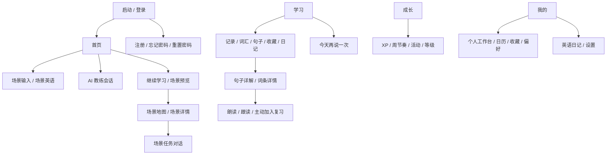
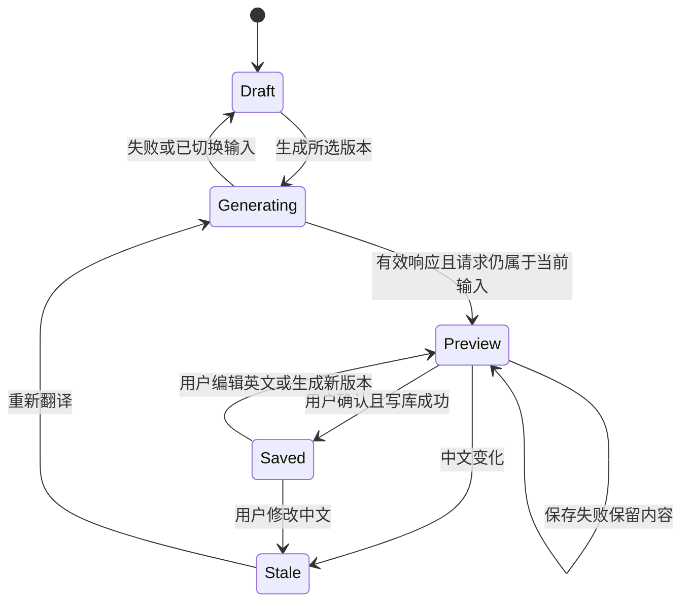
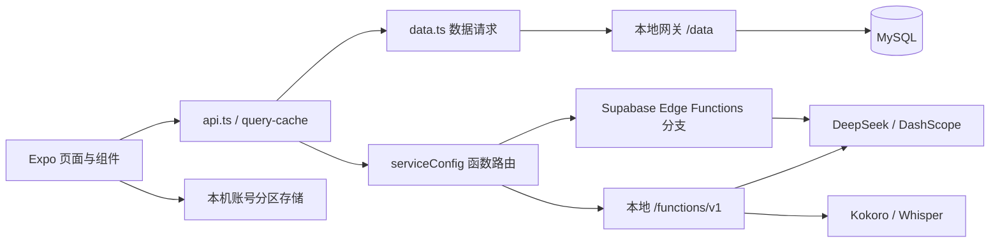

# Visual English Coach 设计与技术说明（当前实现版）

文档版本：CURRENT-2026-11-05-r1
基准日期：2026-11-05，Asia/Shanghai
配套：[当前 PRD](PRD.md)。本文记录当前工作区实现，区分已有设计、验证证据及后续约束，不宣称概念图已做到像素完全一致。

## 1. 设计目标与边界

保留浅色、蓝色强调、实景图片、透明玻璃与物理反馈的产品语言，让“理解、表达、积累、再次使用”有清楚的入口。

当前设计选择：

- 首页采用图片主卡、继续卡组和辅助卡片形成主次；底栏只负责一级导航。
- 阅读/写作页减少装饰层，使用可读性更强的蓝白卡片，不对所有页面强加相同程度的模糊。
- 聊天默认展示会话；帮助、反馈、收藏、解释按需展开，避免一条消息附带多张常驻卡。
- 地图提供自由探索，全部场景开放；学习记录和任务证据代替强制闯关。
- 默认内容与真实个人资产有不同语义；无数据时显示空状态或明确的概念图。

Web 的玻璃效果是透明背景、渐变、高光、边框、阴影与 `backdrop-filter` 的组合，不是 Apple 原生材质。照片和球体等已有静态素材参与视觉构成，不把所有反光称为实时 3D 渲染。

## 2. 信息架构与导航

一级底栏：**首页、学习、成长、我的**。路由配置还保留 `ai-coach`，自定义底栏会将其过滤；AI 教练仍通过首页和既有路由进入。不能仅依据 Tabs.Screen 数量把当前底栏画成五项。

主要路由：

| 领域 | 路由 |
|---|---|
| 身份 | `/sign-in`、`/sign-up`、`/forgot-password`、`/reset-password` |
| 一级页面 | `/home`、`/learning`、`/growth`、`/profile` |
| 场景 | `/thinking-mode`、`/record/[id]`、`/scene-map`、`/scene-detail`、`/scene-dialogue` |
| 学习资产 | `/word-detail`、`/sentence-detail`、`/review`、`/shadowing` |
| 工具 | `/diary`、`/settings`、`/achievements` |
| 兼容入口 | `/ai-coach`、`/dialogue`、`/map`；不作为最新主导航结构的依据 |

## 3. 页面结构与组件职责

### 3.1 首页

- 顶部品牌与连续学习信息。
- 主场景：最近真实记录优先，无记录使用默认概念场景；保留识别入口。
- AI 教练：球体/麦克风视觉负责表达状态，实际内容在会话空间呈现。
- 继续学习：多层卡片、拖拽切换、当前内容与操作同步；点击与拖拽分离。
- 今日目标：使用真实活动与偏好，目标文案“对话与跟读”匹配实际计数。
- 相册：真实可用图片与标注清楚的默认概念图。
- 文字输入、词汇翻卡、场景推荐与学习轨迹作为后续学习入口。

源码：[premium-home-board.tsx](../../src/components/premium-home-board.tsx)、[home.tsx](../../src/app/(app)/(tabs)/home.tsx)。首页带有参考画板比例布局；不能据此认为所有屏幕已完成独立响应式重排，仍需小屏字号和实机检查。

### 3.2 对话与场景任务

- 顶部：当前场景/会话、状态和可展开目标摘要。
- 中部：用户与 AI 消息，流式内容在同一消息中更新。
- 用户原句旁：按需展开建议和重说，避免与另一条原句错配。
- AI 消息操作：主动选择保存表达；不默认展开一整组建议。
- 输入区：中文辅助、关键词或范例按需提供；使用后保留草稿，由用户决定发送。
- 完成/返回：区分练习轮次、AI 任务证据、实际保存与奖励结果。

模块：[ai-coach-conversation.tsx](../../src/components/ai-coach-conversation.tsx)、[learning-loop 组件](../../src/components/learning-loop)、[scene-dialogue.tsx](../../src/app/(app)/scene-dialogue.tsx)。

### 3.3 表达本与句子详解

列表用于筛选和找到真实资产，详情用于理解与操作。句子页顺序：

1. 原句、朗读和中文意思。
2. 整句语气与适用情境。
3. 原句片段及成分解释。
4. 语法/句型说明。
5. 可展开的重点词：本句含义、词性、词形、用法、搭配、双语例句及完整词条。
6. 相近表达及区别。
7. 底部加入情境复习、跟读原句。

中文已有时优先显示；等待解析不清除原句；解析与中文写回分别报错。布局最大内容宽度 760，正文滚动、底部操作独立固定；窄屏需检查底部遮挡和安全区。

源码：[sentence-detail.tsx](../../src/app/(app)/sentence-detail.tsx)、[sentence-learning.ts](../../src/lib/sentence-learning.ts)。

### 3.4 复习

先展示“要表达什么”，再尝试，之后看建议或参考。无情境收藏进入熟悉模式。关键词提示与参考属于不同帮助等级；尝试完成结果由用户主动继续后再切下一条。

UI 状态不以“揭示唯一答案”为核心，不用一组脱离真实输入的自评分按钮代替练习。主观费力程度只参与复习安排。规则见 [review-practice.ts](../../src/lib/learning-loop/review-practice.ts) 和 [review.tsx](../../src/app/(app)/review.tsx)。

### 3.5 日记 v2

阅读态与编辑态共用一个页面：

- 顶部：每日日记 / 每周回顾，日期选择、往期入口。
- 编辑卡：中文输入、字数、可选带入记录、三种表达版本与生成按钮。
- 英语卡：预览或已保存状态；英文可编辑、试听、中文对照、确认保存。
- 文末：折叠实用表达、草稿状态与真实失败提示。
- 日历：月切换、有记录日期打点、未来日期禁用、回到今天。
- 往期：日期与首句摘要，点选后进入对应日期；不把全量长正文同时铺开。
- 个人工作台“编辑这篇日记”传入日期和类型，进入统一编辑器。

参考实际页面：

[英语预览证据](../diary-writing-v2/evidence/preview.png) · [日历证据](../diary-writing-v2/evidence/calendar.png)。这些是实际页面截图，不是全平台或像素级验收证明。

模块：[use-diary-editor.ts](../../src/lib/diary/use-diary-editor.ts)、[calendar.tsx](../../src/components/diary/calendar.tsx)、[expression-list.tsx](../../src/components/diary/expression-list.tsx)。

### 3.6 成长、我的与设置

成长负责学习行为回顾，个人页负责资料、资产与偏好管理。个人数字卡打开具体明细，简单操作尽量在工作台内完成；完整写作、场景任务和句子解释进入对应页面。

成长图表以真实 XP 日期/事件为依据，等级与称号说明不冒充能力测评；没有独立保存勋章获得日期时不推测日期。个人卡使用纯头像与浅色背景。设置展示本地服务状态，不承诺尚不存在的通知或云同步能力。

## 4. 视觉参数：记录现状与统一方向

当前仍存在页面内局部样式，并非已完成全局 Design Token 迁移。以下是代码中可追溯的样例：

| 项目 | 当前样例 | 使用说明 |
|---|---|---|
| 首页强调蓝 | `#087CFF` / `#075EE8` | 高优先级操作、球体和高光 |
| 导航蓝 | `#2F6FED` / `#174EA6` | 选中胶囊及关联状态 |
| 日记背景 / 主按钮 | `#F5F8FF` / `#448FDF` | 写作阅读保持柔和 |
| 句子页背景 / 主按钮 | `#F3F7FD` / `#1978ED` | 解释类内容清晰可读 |
| 日记圆角 | 卡片 23、操作 14 | 局部样式，不是全局固定值 |
| 句子详情圆角 | 内容卡 22、主卡 24 | 与内容层级相关 |
| 内容宽度 | 日记 800、句子页 760 | 页面内有边距，不固定拉满大屏 |
| 文字 | 日记正文 17/30，说明 12/20 | 数值为 React Native 样式逻辑单位 |
| 首页模糊 | 玻璃层分级示例 blur 18/24 | 只在 Web 支持的实现下生效 |

后续统一方向：语义颜色、间距、圆角、阴影和字体集中管理，但保留阅读页与首页的密度差异。此项为维护建议，不能据本表宣称全项目样式已统一。

## 5. 交互与状态设计

### 5.1 通用组件

- `MotionPressable`：按压缩放、Hover 抬升与轻微倾斜、既有触觉支持；减少动态效果时降级。
- `PremiumTabBar`：四项胶囊在路由间移动，先拉伸再回弹，图标/文字跟随选中状态。
- 首页卡组：位移、倾斜、层级、阴影联动；未达到阈值回弹，达到阈值后补位。
- 图片/场景展开：源卡位置进入连续展开/返回；具体性能和所有中断组合未全部实测。

已有弹簧配置位于 [ios-motion.ts](../../src/lib/ios-motion.ts)：按压 damping 24 / stiffness 420 / mass 0.42，导航 25 / 235 / 0.76，空间展开 28 / 235 / 0.82。微交互时长 120/210ms。它们是当前参数，不能替代设备手感验收。

### 5.2 核心状态表

| 组件 | 状态与可操作行为 |
|---|---|
| AI 请求 | 空闲 → 请求中 → 有效结果；失败保留上下文，可重试；取消不留假完成 |
| 录音 | 请求权限 → 录制 → 识别 → 发送/结果；权限拒绝和无识别内容单独提示；与实际录音语义一致 |
| 收藏/保存 | 未保存 → 写入中 → 已保存；失败保留内容、允许重试；不先切成功图标 |
| 词条 | 加载 → 有效词义/已收录；失败可重试，不能显示上一个词的残留 |
| 句子 | 原句/已有中文先显示 → 解析中 → 详情；解析失败和中文回写失败分离 |
| 日记 | 草稿 → 生成中 → 未保存预览 → 已保存；原文改动进入旧译文失效状态 |
| 复习 | 情境/熟悉 → 尝试 → 结果 → 主动继续；跳过有独立语义 |
| 空数据 | 明确没有记录/词汇/日记；只在允许处显示标注的默认概念素材 |

### 5.3 日记状态约束

日期/账号变化后使旧请求失效。源文与候选版本绑定；重新生成不自动替换数据库正文。已有英文手动修改后移除失效表达，不继续展示旧学习卡。

### 5.4 可访问性与性能边界

已增加多处可访问名称、禁用/选中/展开状态、错误提示，部分工作台支持 Escape 和焦点恢复。不能由此推断全部页面已通过屏幕阅读器或键盘审计。

动画优先 transform/opacity，避免拖动每帧更新整个 React 树；玻璃模糊尽量静态，减少同屏大面积动态模糊。原生材质降级、软键盘与真实刷新率仍需设备验收。

## 6. 技术架构与运行模式

技术基线：Expo 55、React 19.2、React Native 0.83、Expo Router；Reanimated/手势、expo-audio、expo-image、NativeWind 与局部 StyleSheet。沿用现有工程，没有为了本轮升级增加另一套动画库。

| 部分 | 当前设计 |
|---|---|
| 前端 | 常用本地地址 8095；localhost 与 127.0.0.1 为不同浏览器来源 |
| 本地网关 | Node `scripts/local-ai-gateway.mjs`，默认仅监听 127.0.0.1:8787 |
| 数据入口 | `src/lib/data.ts` 默认请求本地 `/data`；使用 `X-Local-User-Id` 演示拥有者 |
| 认证 | `src/ctx.tsx`：本地演示身份 / Supabase 真实认证分支 |
| AI 路由 | `isLocalServiceMode` 根据 Supabase 有效配置选择本地或 Edge Functions |
| 文本 AI | DeepSeek 处理聊天、解释、翻译、日记等；具体接口由网关/函数实现 |
| 视觉 AI | DashScope 兼容视觉接口及模型回退，需有效服务额度；硬件链路待验 |
| 语音 | 本地 Kokoro 中英文 TTS、Whisper 英文 ASR；网关还保留其他语音提供方分支 |
| 配置 | 密钥放服务端环境；前端公开配置只放服务地址和允许公开的参数 |

**部署重点：**函数路由切到 Supabase 不代表数据 API 同步切换。当前数据层仍指向配置的数据服务，本地拥有者请求头可由客户端构造；不得把演示身份分区当成生产鉴权。云部署需要另行完成数据服务授权和全链路验证。

## 7. 模块边界与接口契约

| 模块 | UI / 协调 | 纯规则与接口 |
|---|---|---|
| 任务与帮助 | learning-loop 组件、会话容器 | tasks.ts、assistant.ts、共享 learning-assist.mjs |
| 复习 | review.tsx、练习组件 | model.ts、review-practice.ts、repository.ts、store.ts |
| 句子解释 | sentence-detail.tsx | sentence-learning.ts、共享 sentence-detail.mjs |
| 日记 | diary.tsx、calendar、expression-list | use-diary-editor.ts、model.mjs、共享 diary-writing.mjs |
| 个人偏好 | profile-workspace-sheet | profile-preferences.ts |

新增解释/日记契约由本地与云端共用，避免两套字段与校验规则分叉。

### 7.1 句子接口

`sentence-detail` 输入原句与可选场景。输出原句、中文、整句解释、结构片段、语法点、重点词与替代表达。结构校验确保原句一致、重点片段来自原文、必需中文存在；无法自动保证全部语言学事实正确。请求结果按账号缓存，前端超时/失效控制，中文写回独立处理。

### 7.2 日记接口

`diary` 支持：

- `translate`：`source`（最多4000字符）、`mode`（natural/simple/polished）。
- `weekly`：优先 `diaries`，无有效日记才用 `records`。
- `from-records`：兼容既有记录生成路径，不是当前自由写作的前置条件。

输出：`content`、`source_text`、`expressions`、`mode`。翻译时源文取请求原文，不能让模型覆盖中文；最多 3 条拓展表达，只保留实际正文内且有中文用法的条目。可选表达无效时过滤，保留有效日记；正文无效则报错。

模型调用不直接写库。保存由用户确认后经数据 API 写入，因此“生成成功”和“日记已保存”是两个状态。

## 8. 数据设计与持久化

### 8.1 现有 MySQL 表

| 表 | 关键字段/用途 |
|---|---|
| learning_records | 输入类型、图片/文字、场景、三段表达、难度、备注、收藏、跟读结果 |
| words | 单词、音标、释义、词性、搭配、例句；账号+词唯一 |
| sentences | 原句、中文、关联记录；收藏与学习表达资产 |
| scenes | 场景名称、图片、练习次数、最近练习 |
| user_stats | 累计行为、XP、等级、签到/连续学习 |
| daily_stats | 日期对应的场景、词汇、对话、跟读计数等；部分字段不代表已完整使用 |
| diaries | 类型、英文、所属日期/周、中文、写作模式、来源及学习表达 |
| high_freq_words | 单词/日期出现次数 |
| xp_logs | 奖励来源、数值、奖励日期；按账号/来源/日期唯一 |
| scene_map_progress | 新版场景状态、轮次、最近练习 |
| scene_progress | 兼容旧地图的进度字段，不等同新版 UI 解锁规则 |

表定义：[mysql/schema.sql](../../mysql/schema.sql)。存在某个字段不代表对应产品功能已交付，例如 `study_minutes`、`mastery` 不应自动包装成经过验证的能力指标。

### 8.2 日记兼容扩展

`00006` 增加可空字段：`source_text`、`writing_mode`、`source_kind`、`learning_expressions`。MySQL 使用文本/varchar/JSON；Supabase 迁移使用 text/jsonb。原英文 `content` 保留，旧数据不批量重写。

本地迁移 `scripts/migrate-diary-writing.mjs` 可重复执行；mysql:init 也补齐字段。现有客户端顺序保存复用同日记录；没有数据库日期唯一约束，不处理多设备冲突合并，不自动删除历史重复日记。

### 8.3 本机存储与缓存

| 数据 | 范围 | 说明 |
|---|---|---|
| 复习队列/历史 | 账号、本机 | 最多300条，每条最近20次新历史；不是云同步 |
| 日记草稿/候选 | 账号 + daily日期 / weekly周 | Web localStorage，原生使用既有KV；版本化读取，串行写入 |
| 昵称/称号/偏好 | 账号、本机 | 现有 profile-preferences 存储与订阅 |
| 已保存学习/日记 | 数据服务 | 以服务请求成功为准，成功后失效相关查询 |
| 查询缓存 | 拥有者 + 查询键 | 请求去重、失效通知；切身份清缓存，避免旧请求写入新视图 |

缓存并非离线数据库。句子详解缓存不能替代原句所有权检查；日期、源文、账号变化要使旧请求结果失效。

### 8.4 XP 一致性

活动和奖励事务入口使用一致的账号行排他锁，解决并发插入后锁升级造成的死锁；重复奖励受唯一键和事件规则约束。未改变既有奖值。数据库日期和客户端本地日期在跨时区部署前需统一业务口径。

## 9. 验证与交付

最近已记录结果（2026-11-05）：

| 层次 | 证据 |
|---|---|
| 纯规则 | `test:learning` 46、`test:sentences` 9、`test:diary` 15 |
| 静态/构建 | 类型、109文件lint、Web export、diff检查 |
| 数据 | `smoke:local`、`smoke:concurrency`、日记双语写读更新 |
| AI | `smoke:learning`、`smoke:diary` 真实接口 |
| 语音 | Kokoro→Whisper 合成输入，浏览器实际音频播放 |
| 页面 | 对话、句库、复习、日期草稿、错误恢复、部分小屏 |

独立测试账号与合成内容，不清空真实用户数据。详细证据以模块文档为准；本轮仅整理文档，没有重新运行这些验收。

尚未验收/部署：真人麦克风、实体相机及头像文件读取、iOS/Android/Safari实机、软键盘横屏、全部旧路由、真实60fps与低端机、云端全数据链路、生产认证授权和多设备编辑。

## 10. 后续设计与维护约束

- 新增“今日练习”“日记转口语”“自适应难度”时复用既有会话/复习，不重复铺一套收藏、帮助和反馈。
- 保持场景自由进入，不恢复强制解锁；XP 与语言能力证据分开。
- 不无故叠加动画库；长页面和图片优先考虑资源、文本可读性和低端性能。
- 密钥、原始私人日记、密码和录音不进入设计文档或公开测试样本。
- 生产化需优先修订认证、数据授权、存储同步和 API 部署，不仅替换前端服务地址。

## 11. 追溯与历史冲突

- [当前进度索引](README.md)
- [最近日记验收](../diary-writing-v2/05-acceptance.md)
- [句子详解验收](../sentence-library-v1/02-acceptance.md)
- [复习 v2](../review-v2/00-progress.md)
- [对话 v2](../conversation-ui-v2/00-progress.md)
- [核心冒烟边界](../project-smoke-20261104/02-browser-acceptance.md)

旧 `docs/prd.md`、`migration-status.md` 和个人工作台早期记录保留历史。其中专业发音测评、场景关卡、旧日记自动保存/面板编辑、早期lint失败等描述应按最新代码和模块验收解读，不直接复用成当前承诺。
